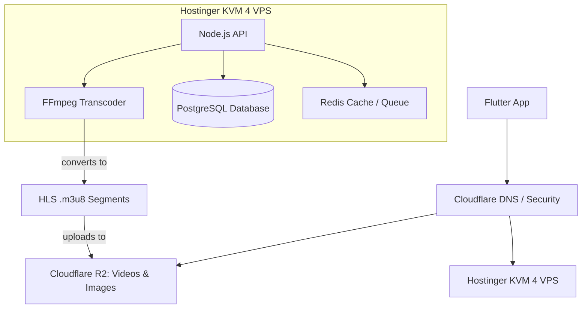

# Narmadanchal Smart Classes: System Architecture

This document defines the complete architecture to replace Firebase entirely with a custom Backend on Hostinger (KVM 4 VPS) and Cloudflare.

## Architecture Model

### Components Details:
1. **Frontend (Flutter App & Admin Panel)**: Will communicate entirely via REST APIs (no more Firebase SDK).
2. **Security**: Cloudflare handles DDoS protection, HTTPS, and caching.
3. **VPS Server (KVM 4)**: Runs Docker containers for the Node.js API, PostgreSQL database, and Redis.
4. **Media Processing**: FFmpeg is used on the VPS to convert raw `.mp4` uploads into optimized `HLS` chunks.
5. **Storage (Cloudflare R2)**: Stores all App media (Videos, PDFs, Thumbnails) with zero egress fees.

---

## Progress Tracker
*We will update this section as we complete tasks so we never lose track.*

- [x] **VPS Provisioned:** Hostinger KVM 4 purchased.
- [x] **Backend Skeleton:** Node.js project created with Express, BullMQ, and Redis.
- [x] **Database Schema:** Prisma ORM installed and PostgreSQL schema (`schema.prisma`) designed.
- [x] **Docker Configured:** `docker-compose.yml` set up for local and production VPS environments.
- [x] **Transcoder Optimized:** FFmpeg configured to run with `-preset ultrafast` and `-threads 4` for extreme speed on KVM 4.
- [ ] **Database Deployment:** Spin up PostgreSQL on VPS and push the Prisma schema.
- [ ] **Build API Endpoints:** Write REST APIs to replace Firestore queries (Auth, Courses, Lectures).
- [ ] **Refactor Flutter App:** Remove `cloud_firestore` and integrate API endpoints.
- [ ] **Refactor Admin Panel:** Point admin panel data fetches to the new Node.js API.
- [ ] **Data Migration:** Run script to copy old Firebase data to PostgreSQL and Cloudflare R2.
- [ ] **Go Live:** Update DNS to point to the new Hostinger KVM API.
